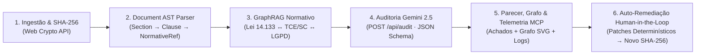

# GovShield Audit Studio

Plataforma de **auditoria pericial, conformidade jurídica, grafo normativo e auto-remediação assistida** para editais e contratos públicos brasileiros, desenvolvida para detectar ilegalidades, riscos de impugnação e lacunas de cibersegurança/privacidade antes da publicação do certame.

---

## Sumário

1. [Missão da Plataforma e Eixos Normativos](#1-missão-da-plataforma-e-eixos-normativos)
2. [Principais Capacidades](#2-principais-capacidades)
3. [Stack Técnico](#3-stack-técnico)
4. [Arquitetura Enterprise (DDD, BPMN, SOA, AST, GraphRAG & MCP)](#4-arquitetura-enterprise-ddd-bpmn-soa-ast-graphrag--mcp)
5. [Estrutura do Repositório](#5-estrutura-do-repositório)
6. [Configuração do Ambiente e Execução](#6-configuração-do-ambiente-e-execução)
7. [Guia de Uso para Auditores e Procuradores](#7-guia-de-uso-para-auditores-e-procuradores)
8. [Conformidade Legal (Lei nº 14.133/2021, TCE/SC e LGPD)](#8-conformidade-legal-lei-nº-141332021-tcesc-e-lgpd)
9. [Segurança, Determinismo e Governança Human-in-the-Loop](#9-segurança-determinismo-e-governança-human-in-the-loop)
10. [Licença](#10-licença)

---

## 1. Missão da Plataforma e Eixos Normativos

A missão do **GovShield Audit Studio** é reduzir o risco jurídico, financeiro e cibernético nas contratações públicas brasileiras antes da publicação do edital, oferecendo a procuradores, pregoeiros, controladores internos e auditores de TI uma esteira pericial rastreável, determinística e auditável sobre três pilares normativos:

| Eixo Normativo | Foco de Verificação e Riscos Mapeados |
| :--- | :--- |
| **Lei nº 14.133/2021** | Direcionamento de marca ou solução proprietária (arts. 9º e 41), teto e somatório de atestados (art. 67, § 2º), parcelamento do objeto (art. 40, § 2º), facultatividade de vistoria técnica (art. 63, §§ 2º–3º), vínculo trabalhista prévio (art. 67, I), índice de reajuste e matriz de alocação de riscos (arts. 22 e 92). |
| **Jurisprudência TCE/SC** | Restrição territorial prévia (exigência de sede/filial local antes da contratação), aglutinação indevida de software, hardware e serviços contínuos em lote único, exigência de atestado em contrato único e barreiras injustificadas à competitividade. |
| **LGPD (Lei nº 13.709/2018) e Cibersegurança** | Tratamento de dados pessoais sensíveis e biométricos pelo Poder Público (arts. 11, 23 e 26), transferência internacional sem garantias (art. 33), exigência de RIPD e Encarregado/DPO (arts. 38 e 41), anonimização, criptografia em repouso/trânsito, descarte seguro de backups e SLA de notificação de incidentes (arts. 46 e 48). |

---

## 2. Principais Capacidades

- **Leitura Nativa Multimodal (`PDF`, `.txt`, `.md`, `.csv`)**: arquivos PDF são convertidos em Base64 e analisados integralmente via `inlineData` no modelo `gemini-2.5-flash`, preservando tabelas, anexos e numeração de cláusulas.
- **Cadeia de Custódia Criptográfica (`SHA-256`)**: cálculo real no navegador via Web Crypto API (`window.crypto.subtle.digest`) na ingestão e recálculo em tempo real após aplicação de correções na minuta.
- **Saída Estruturada Estrita (`AuditReport`)**: schema JSON determinístico (`temperature: 0.1`) com classificação de risco (`0–100`), status jurídico, fundamentação legal, trecho literal (*ipsissima verba*), impacto operacional e redação substitutiva completa.
- **Auto-Remediação Assistida (Minuta Retificada + Diff Rastreado)**: fluxo inspirado em *Pull Requests* de DevSecOps com checkboxes *Human-in-the-Loop*, visualização **Antes vs. Depois** (`-` vermelho riscado vs. `+` verde esmeralda), recálculo instantâneo do **SHA-256 da Minuta Saneada** e download em `.txt` ou `.md`.
- **Grafo de Dependências Interativo em SVG**: visualização em camadas ligando nós (`CLAUSULA`, `LEI`, `RISCO`, `SECRETARIA`) por relações semânticas (`VIOLA`, `EXIGE`, `IMPACTA`) com destaque de vizinhança e painel lateral de inspeção.
- **3 Editais de Demonstração Integrados**: cenários realistas pré-configurados (*Saúde Digital / SMS Florianópolis*, *Mobilidade SC / Concorrência SIE* e *Gestão Tributária / SEFAZ Joinville*) para demonstração instantânea sem depender de upload externo.

---

## 3. Stack Técnico

- **Interface & Design System:** React 19, TypeScript, Tailwind CSS v4, Lucide React
- **Backend / API Proxy:** Node.js 22+, Express 4, `tsx`, `dotenv`
- **Motor Pericial de IA:** SDK oficial `@google/genai` (`gemini-2.5-flash`)
- **Criptografia:** Web Crypto API (`SHA-256` nativo no cliente)
- **Build & Verificação:** Vite 8, TypeScript Compiler (`tsc --noEmit`)

---

## 4. Arquitetura Enterprise (DDD, BPMN, SOA, AST, GraphRAG & MCP)

A lógica de domínio e orquestração é isolada da camada visual React, operando em pipeline BPMN de 5 estágios com fechamento criptográfico na etapa de remediação:



### Camadas e Responsabilidades

- **Domínio (`src/domain/`):**
  - `src/domain/ast/documentAstParser.ts`: parser determinístico em TypeScript puro que transforma o texto do edital em árvore hierárquica (`DocumentAstRoot → SectionNode → ClauseNode → NormativeRefNode`) e mapeia cada achado para seu endereço estrutural exato (ex.: `Seção 2 > Item 2.3`).
  - `src/domain/graphrag/normativeGraphEngine.ts`: sintetiza cruzamentos normativos entre Lei nº 14.133/2021, TCE/SC e LGPD para enriquecer o contexto da auditoria e calcula métricas estruturais do grafo de dependências.
  - `src/domain/mcp/mcpToolRegistry.ts`: camada de ferramentas no padrão **MCP (Model Context Protocol)** (`verify_sha256_custody`, `parse_document_ast`, `query_graphrag_normative`, `run_gemini_compliance_audit`), registrando duração em `ms` e status auditável de cada etapa.
  - `src/domain/orchestrator/auditBpmnOrchestrator.ts`: orquestra sequencialmente o pipeline BPMN e consolida o `EnterpriseAuditBundle`.
- **Serviços & Proxy SOA (`server.ts` + `src/services/`):**
  - `server.ts`: servidor Express que atende o frontend Vite e expõe `POST /api/audit`, mantendo `GEMINI_API_KEY` estritamente no backend. Configura `temperature: 0.1`, `responseMimeType: "application/json"` e `responseSchema` aderente a `AuditReport`.
  - `src/services/auditPromptConfig.ts`: define o `systemInstruction` pericial com regra anti-alucinação (*ipsissima verba* no `trecho_original`) e proibição de placeholders genéricos em `sugestao_retificacao`.
  - `src/services/geminiAuditService.ts`: cliente SOA para consumo de `/api/audit` e executor dos casos de referência.
  - `src/services/redlinePatchService.ts`: motor **100% determinístico e offline** (zero chamadas de API) que aplica os patches selecionados sobre `originalText` (substituição literal, fallback tolerante a quebras de linha e adendo estruturado para PDFs binários), gera conteúdo exportável `.txt`/`.md` e recalcula o novo `rectifiedSha256`.

---

## 5. Estrutura do Repositório

```text
├── server.ts                                    # Servidor Express + endpoint POST /api/audit (@google/genai)
├── index.html                                   # Entry point HTML e metadados
├── package.json                                 # Dependências e scripts npm
├── .env.example                                 # Modelo de variáveis de ambiente
└── src/
    ├── App.tsx                                  # Estado raiz da aplicação e coordenação de views
    ├── index.css                                # Configuração Tailwind CSS v4 (tema forense dark)
    ├── types/
    │   └── audit.ts                             # Contratos estritos (AuditReport, AuditFinding, DependencyGraph)
    ├── domain/
    │   ├── ast/documentAstParser.ts             # Parser determinístico Document AST
    │   ├── graphrag/normativeGraphEngine.ts     # Motor GraphRAG e métricas de grafo
    │   ├── mcp/mcpToolRegistry.ts               # Registro e telemetria de tools MCP
    │   └── orchestrator/auditBpmnOrchestrator.ts# Orquestrador BPMN em 5 estágios
    ├── services/
    │   ├── auditPromptConfig.ts                 # Regras periciais e prompt do Gemini 2.5
    │   ├── geminiAuditService.ts                # Cliente /api/audit e casos de demonstração
    │   └── redlinePatchService.ts               # Motor determinístico de patches e recálculo SHA-256
    ├── utils/
    │   ├── cryptoAndAnalysis.ts                 # Web Crypto SHA-256, leitura de arquivos e editais modelo
    │   └── graphFindingMatcher.ts               # Correlação bidirecional entre achados e nós do grafo
    └── components/
        ├── TopBar.tsx                           # Barra superior, navegação e ação Exportar Parecer
        ├── IngestionPanel.tsx                   # Upload, editais modelo, cadeia SHA-256 e escopo normativo
        ├── AuditWorkspace.tsx                   # Cabeçalho executivo, KPIs e roteamento das abas periciais
        ├── BpmnPipelineBar.tsx                  # Barra de progresso e trilha BPMN
        ├── FindingsList.tsx                     # Cards de achados com filtros, AST e cópia de retificação
        ├── RedlineDiffView.tsx                  # Aba Minuta Retificada (Diff), checkboxes e download .txt/.md
        ├── DependencyGraphView.tsx              # Grafo SVG interativo em camadas + inspetor de nó
        ├── EnterpriseArchitectureView.tsx       # Inspeção de Document AST, GraphRAG e telemetria MCP
        └── NormativeReferenceView.tsx           # Base normativa consolidada (Lei 14.133, TCE/SC, LGPD)
```

---

## 6. Configuração do Ambiente e Execução

### Pré-requisitos

- **Node.js 22+** e **npm**
- Chave de API do Google Gemini (`GEMINI_API_KEY`)

### Instalação

```bash
npm install
```

### Variáveis de Ambiente

Crie o arquivo `.env` a partir do template `.env.example`:

```bash
cp .env.example .env
```

Preencha as variáveis:

```env
GEMINI_API_KEY="SUA_CHAVE_GEMINI_API"
APP_URL="http://localhost:3000"
```

### Comandos Disponíveis

```bash
# Servidor de desenvolvimento (Express + Vite middleware na porta 3000)
npm run dev

# Verificação estrita de tipos TypeScript
npm run lint

# Build de produção
npm run build

# Execução em produção
NODE_ENV=production npm start
```

---

## 7. Guia de Uso para Auditores e Procuradores

1. **Ingestão e Cadeia de Custódia (`01` a `04` na barra lateral):**
   - Envie um arquivo **PDF** (leitura multimodal nativa em Base64) ou texto (`.txt`, `.md`, `.csv`), cole cláusulas no editor ou selecione um dos **3 Editais de Referência**.
   - Confira o digest **SHA-256** calculado em **03. Cadeia de Custódia** antes de iniciar a auditoria.
   - Marque o escopo desejado em **04. Escopo Normativo Ativo** (`Lei nº 14.133/2021`, `TCE/SC`, `LGPD`) e clique em **Executar Auditoria Pericial**.
2. **Inspeção dos Achados (`Achados`):**
   - Avalie o **Score de Risco Global (`0–100`)**, o status jurídico do certame e filtre os apontamentos por severidade (`CRÍTICO`, `ALTO`, `MODERADO`) ou categoria.
   - Verifique o endereçamento estrutural **AST** (`Seção X > Item Y.Z`), o `trecho_original` literal e utilize **Copiar Sugestão de Retificação** para colar a redação saneada diretamente em minutas externas.
3. **Auto-Remediação Assistida (`Minuta Retificada (Diff)`):**
   - Marque ou desmarque as **checkboxes** de cada achado para decidir quais correções comporão a minuta final.
   - Analise o **Diff Antes vs. Depois** (`- Trecho Original` em vermelho riscado vs. `+ Redação Saneada` em verde esmeralda).
   - Acompanhe em tempo real a atualização da cadeia de custódia: `SHA-256 Original → Cláusulas Saneadas → Novo SHA-256 da Minuta Saneada`.
   - Clique em **Baixar Edital Retificado (.txt)** ou **Baixar Edital Retificado (.md)** para gerar o arquivo consolidado com cabeçalho criptográfico pronto para validação e assinatura.
4. **Grafo de Dependências e Auditoria Técnica (`Grafo`, `Arquitetura MCP`, `Contrato JSON`):**
   - Navegue no grafo SVG clicando em nós (`CLAUSULA`, `LEI`, `RISCO`, `SECRETARIA`) ou salte direto de um achado pelo botão **Grafo**.
   - Inspecione a árvore **Document AST**, as ligações **GraphRAG**, os logs **MCP** e o payload JSON completo em **Contrato JSON**, ou baixe o parecer integral pelo botão **Exportar Parecer** no topo.

---

## 8. Conformidade Legal (Lei nº 14.133/2021, TCE/SC e LGPD)

Cada apontamento gerado pelo motor pericial e correlacionado pelo GraphRAG é classificado em uma das três categorias tipadas em `src/types/audit.ts`:

- **`VIOLACAO_LEGAL` — Lei nº 14.133/2021 (Nova Lei de Licitações e Contratos):**
  - Verificação de restrições indevidas à competitividade e direcionamento de marca sem justificativa técnica formal (arts. 9º e 41).
  - Conferência de exigências de qualificação técnico-operacional acima do teto legal de 50% ou com vedação ao somatório de atestados (art. 67, § 2º).
  - Validação da facultatividade de vistoria presencial mediante declaração formal de pleno conhecimento (art. 63, §§ 2º–3º), vedação de vínculo empregatício prévio na data do certame (art. 67, I), e obrigatoriedade de critério de reajuste e matriz de alocação de riscos (arts. 22 e 92).
- **`RISCO_IMPUGNACAO_TCESC` — Jurisprudência dos Tribunais de Contas (TCE/SC):**
  - Identificação de cláusulas de restrição territorial prévia (exigência de sede/filial local antes da assinatura do contrato).
  - Detecção de aglutinação indevida de objetos heterogêneos (software SaaS, hardware e serviços contínuos) sem parcelamento justificado (art. 40, § 2º e entendimentos do TCE/SC).
  - Mapeamento de exigências desproporcionais de atestado em contrato único que elevam a probabilidade de suspensão cautelar do certame.
- **`LACUNA_CIBER_LGPD` — LGPD (Lei nº 13.709/2018) e Segurança da Informação:**
  - Auditoria de cláusulas envolvendo dados pessoais sensíveis, dados biométricos ou prontuários médicos pelo Poder Público (arts. 11, 23 e 26).
  - Verificação de transferência internacional de dados sem salvaguardas adequadas (art. 33), ausência de exigência de Relatório de Impacto à Proteção de Dados (RIPD — art. 38) e ausência de indicação de Encarregado/DPO (art. 41).
  - Conferência de medidas técnicas de segurança (criptografia em repouso/trânsito, anonimização, descarte seguro de backups) e definição objetiva de prazo de notificação de incidentes à Administração e à ANPD (arts. 46 e 48).

---

## 9. Segurança, Determinismo e Governança Human-in-the-Loop

- **Segregação de Credenciais:** `GEMINI_API_KEY` permanece exclusivamente no servidor Express (`server.ts`), nunca sendo exposta ao bundle do navegador.
- **Integridade Verificável:** nenhum hash SHA-256 é gerado por LLM; tanto o hash de entrada quanto o hash pós-remediação são calculados deterministicamente no navegador via Web Crypto API.
- **Regra *Ipsissima Verba*:** os achados reportam citações literais do documento auditado e sugestões sem placeholders entre colchetes.
- **Aprovação Humana Obrigatória:** todas as correções aplicadas na aba **Minuta Retificada** são operadas sob o status explícito **`Aguardando Assinatura da Autoridade Competente (Human-in-the-Loop)`**, preservando a responsabilidade decisória do procurador ou pregoeiro.

---

## 10. Licença

Distribuído conforme cabeçalhos SPDX do repositório (`Apache-2.0`).
