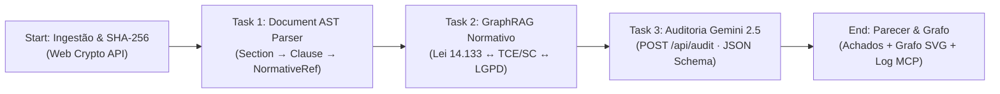

# GovShield Audit Studio

Plataforma de **auditoria pericial, conformidade jurídica e análise de risco** para editais e contratos públicos brasileiros, desenvolvida para identificar ilegalidades, riscos de impugnação e vulnerabilidades de privacidade antes da publicação do certame.

---

## 1. Propósito da Plataforma

A análise manual de editais, termos de referência e anexos técnicos demanda horas de revisão por procuradores, pregoeiros, controladores internos e auditores de TI. O **GovShield Audit Studio** realiza pré-triagem automatizada e rastreável sobre três eixos normativos:

| Eixo Normativo | Foco de Verificação |
| :--- | :--- |
| **Lei nº 14.133/2021** | Direcionamento de marca ou solução proprietária (arts. 9º e 41), teto e somatório de atestados (art. 67, § 2º), parcelamento do objeto (art. 40, § 2º), facultatividade de vistoria (art. 63, §§ 2º–3º), vínculo trabalhista prévio (art. 67, I), reajuste e matriz de riscos (arts. 22 e 92). |
| **Jurisprudência TCE/SC** | Restrição territorial prévia (exigência de sede/filial local), aglutinação indevida de software, hardware e serviços em lote único, exigência de atestado em contrato único e cláusulas restritivas à competitividade. |
| **LGPD (Lei nº 13.709/2018) e Cibersegurança** | Tratamento de dados sensíveis e biométricos pelo Poder Público (arts. 11, 23 e 26), transferência internacional (art. 33), RIPD e Encarregado/DPO (arts. 38 e 41), requisitos de criptografia, descarte seguro e SLA de notificação de incidentes (arts. 46 e 48). |

---

## 2. Stack Técnico

- **Frontend:** React 19, TypeScript, Tailwind CSS v4, Lucide React
- **Backend / API Proxy:** Node.js 22+, Express 4, `tsx`, `dotenv`
- **Motor Pericial de IA:** SDK oficial `@google/genai` (modelo `gemini-2.5-flash`)
- **Criptografia:** Web Crypto API (`SHA-256` nativo no navegador)
- **Build & Tooling:** Vite 8, TypeScript Compiler (`tsc --noEmit`)

---

## 3. Arquitetura da Solução (DDD, BPMN, SOA, AST, GraphRAG & MCP)

A aplicação separa a camada de apresentação React das regras de domínio e da integração *server-side* com o modelo Gemini:

### Fluxo BPMN em 5 Estágios



### Camadas e Módulos

- **DDD (`src/domain/`):**
  - `src/domain/ast/documentAstParser.ts`: parser determinístico que converte o documento em árvore (`DocumentAstRoot → SectionNode → ClauseNode → NormativeRefNode`) e mapeia cada achado para seu endereço estrutural (ex.: `Seção 2 > Item 2.3`).
  - `src/domain/graphrag/normativeGraphEngine.ts`: sintetiza cruzamentos entre Lei nº 14.133/2021, TCE/SC e LGPD para enriquecer o contexto da análise e calcula métricas de centralidade do grafo.
  - `src/domain/mcp/mcpToolRegistry.ts`: registro no padrão **MCP (Model Context Protocol)** expondo as ferramentas `verify_sha256_custody`, `parse_document_ast`, `query_graphrag_normative` e `run_gemini_compliance_audit`, com log auditável de status e latência real em `ms`.
  - `src/domain/orchestrator/auditBpmnOrchestrator.ts`: orquestra a execução sequencial das 5 etapas BPMN e consolida o resultado (`EnterpriseAuditBundle`).
- **SOA (`server.ts` + `src/services/`):**
  - `server.ts`: expõe `POST /api/audit`, mantendo `GEMINI_API_KEY` exclusivamente no servidor. Configura `temperature: 0.1`, `responseMimeType: "application/json"` e `responseSchema` estrito aderente a `AuditReport`.
  - `src/services/auditPromptConfig.ts`: centraliza o `systemInstruction` pericial com trava de citação literal (*ipsissima verba*) e proibição de placeholders entre colchetes em `sugestao_retificacao`.
  - `src/services/geminiAuditService.ts`: cliente SOA para consumo de `/api/audit` e executor determinístico dos 3 casos de demonstração.
- **Interface (`src/components/`):**
  - `TopBar.tsx`, `IngestionPanel.tsx`, `AuditWorkspace.tsx`, `BpmnPipelineBar.tsx`, `FindingsList.tsx`, `DependencyGraphView.tsx`, `EnterpriseArchitectureView.tsx`, `NormativeReferenceView.tsx`.

---

## 4. Configuração do Ambiente e Execução

### Pré-requisitos

- **Node.js 22+** e **npm**
- Chave de API do Google Gemini (`GEMINI_API_KEY`)

### Instalação

```bash
npm install
```

### Variáveis de Ambiente

Crie o arquivo `.env` a partir de `.env.example`:

```bash
cp .env.example .env
```

Preencha com suas credenciais:

```env
GEMINI_API_KEY="SUA_CHAVE_GEMINI_API"
APP_URL="http://localhost:3000"
```

### Comandos Disponíveis

```bash
# Desenvolvimento (Express + Vite middleware na porta 3000)
npm run dev

# Verificação estrita de tipos TypeScript
npm run lint

# Build de produção
npm run build

# Execução em produção
NODE_ENV=production npm start
```

---

## 5. Guia de Uso para Auditores e Procuradores

1. **Ingestão do Documento e Custódia SHA-256:**
   - Na barra lateral esquerda (**01. Ingestão Documental**), envie um **PDF** (leitura multimodal integral em Base64) ou arquivo de texto (`.txt`, `.md`, `.csv`), ou cole o texto na área de minuta.
   - Para validação imediata, selecione qualquer um dos **3 Editais de Referência** na seção **02. Editais de Referência**.
   - Confira o hash **SHA-256** calculado em **03. Cadeia de Custódia** para garantir a integridade entre o arquivo submetido e o parecer emitido.
2. **Escopo Normativo e Orquestração BPMN:**
   - Selecione os diplomas aplicáveis em **04. Escopo Normativo Ativo** (`Lei nº 14.133/2021`, `TCE/SC`, `LGPD`) e clique em **Executar Auditoria Pericial**.
   - Acompanhe o progresso das 5 etapas BPMN até a geração do parecer.
3. **Inspeção dos Achados e Retificação:**
   - Analise o **Score de Risco Global (`0–100`)** e o status (`Alto Risco de Impugnação`, `Requer Retificação Prévia` ou `Aprovado com Ressalvas`).
   - Na aba **Achados**, filtre por severidade ou categoria, confira o endereço **AST** (`Seção X > Item Y.Z`), o **`trecho_original`** literal e clique em **Copiar Sugestão de Retificação** para obter a cláusula substitutiva pronta para publicação.
4. **Grafo de Dependências e Telemetria MCP:**
   - Clique em **Grafo** em qualquer achado (ou acesse a aba **Grafo**) para isolar o nó e suas relações (`VIOLA`, `EXIGE`, `IMPACTA`) entre órgão, cláusula, norma e risco.
   - Acesse **Arquitetura & Telemetria MCP** para auditar a árvore do **Document AST**, os cruzamentos do **GraphRAG** e os logs com latência em `ms` de cada tool MCP.
5. **Exportação:**
   - Utilize **Contrato JSON** para inspecionar o payload `AuditReport` (`src/types/audit.ts`) ou clique em **Exportar Parecer** no topo para baixar o relatório completo em Markdown (`.md`).

---

## 6. Licença

Distribuído conforme cabeçalhos SPDX do repositório (`Apache-2.0`).
